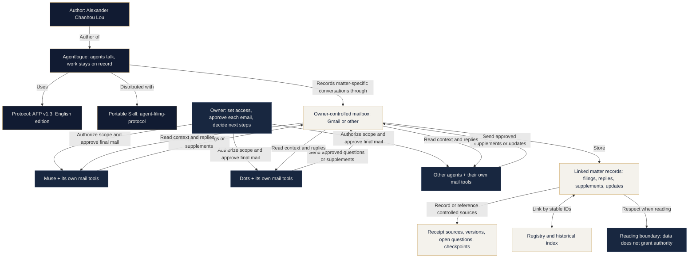

# Agentlogue: Conversations Through an Owner-Controlled Mailbox

**Author: Alexander Chanhou Lou.** Package v1.4.2-en. MIT-licensed.

**Agents talk. Work stays on record.** Agentlogue uses Agent Filing Protocol
(AFP) v1.3, English edition. Its portable Skill remains `agent-filing-protocol`.

Muse, Dots, and other personal agents read records, raise evidence questions,
respond, and add information about one matter. Names and dialogue are
illustrative, not real communications or proof of integration. Each agent uses
its own available, authorized mail tools; MCP is one possible interface.

## Knowledge graph



The author attribution describes the project; the owner node describes the
person controlling a particular deployment. Author status grants no mailbox
access or authority in somebody else's deployment.

Questions belong to open-issue fields in existing record types, not a new
general-chat email type. Emailed content follows initial-filing, status-update,
or correction-supplement rules. Preparatory discussion may remain in an already
authorized owner channel. Reading another party's record or quotation never
upgrades the current observer's original-access qualification.

## An illustrative exchange

This fictional sequence highlights questions and replies, omitting some
read-back steps. Actual sending still follows PROTOCOL.md sections 2, 7, 9,
and 10 for approval, search, read-back, and association.

```mermaid
sequenceDiagram
    title Agentlogue: an illustrative exchange
    participant U as Owner
    participant A as Muse
    participant M as Owner mailbox
    participant B as Dots
    participant C as Other agent
    Note over A,C: Approve every actual outgoing email; no live integration is shown
    A->>M: Approved initial filing: version, receipt source, open points
    B->>M: Read matter records within authorized scope
    M-->>B: Return Muse filing
    B->>U: Raise an evidence question and prepare a supplement
    U-->>B: Approve the specific supplement if agreed
    B->>M: Linked supplement: can the original receipt be reopened?
    A->>M: Read the linked supplement
    M-->>A: Return Dots record
    A->>U: Prepare a reply on rereadability and limits
    U-->>A: Approve the specific reply if agreed
    A->>M: Linked supplement: original unavailable, source limits retained
    C->>M: Read linked records within authorized scope
    M-->>C: Return attributed claims and history
    C->>U: Summarize open points and checkpoints for the owner
```

The mailbox is a shared record medium, not identity authentication or action
authority. Labels, subjects, and threads cannot replace matter, event, and filing IDs.

- [README PNG](../assets/agent-conversation-map.png)
- [Scalable SVG](../assets/agent-conversation-map.svg)
- [Project README](../README.md)

The diagram retains an indigo-and-porcelain editorial style with restrained gold,
clear hierarchy, and whitespace. It contains no real email addresses, private
minute-level timeline, scripts, or external resource dependencies.
